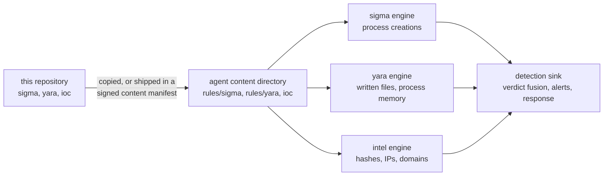

# Synthaea Rules: technical documentation

This repository holds the detection content of [Synthaea](https://github.com/synthaea-lab/agent):
the Sigma and YARA rules the endpoint agent evaluates locally. It contains no code. The engines
that load and run the rules live in the agent repository, and so do the test suites that judge
every rule here. These pages explain the formats, the conventions this repository adds on top of
them, how the content reaches an agent, and how a change is validated.

> [!WARNING]
> Synthaea is alpha software, and so is this content. The directory layout, the sample format
> and the set of supported Sigma features change between versions.

## Where the content fits

- **Sigma rules** (`sigma/<platform>/*.yml`) match process-creation events: the image path, the
  raw command line and the parent image. They run on the agent's capture thread, so the rule
  language is a deliberately small, bounded subset of Sigma.
- **YARA rules** (`yara/<category>/*.yar`) match the bytes of files written on the host and, on
  Linux, the executable anonymous memory of a process another detection points at.
- **IOC feeds** (`ioc/*.txt`) are lists of SHA-256 hashes, IP addresses and domains. The
  repository ships none yet, but its validation already covers the directory.

The agent judges events on the endpoint, without the network. A rule that loads here behaves the
same on a host with no control plane. What the control plane adds is distribution: signed
content manifests, per rollout ring.

## Design principles

Three choices shape everything in this repository:

1. **Content is tested against the real engines.** No separate linter decides whether a rule is
   valid. The content suites in the agent repository load this tree with the same code the agent
   runs, so "valid here" and "loads on a host" cannot drift apart.
2. **A rule nothing can trigger is dead content.** Every Sigma rule carries a matching event and a
   near miss, and every YARA rule has a matching and a non-matching sample in the agent's suite.
   A rule without both fails validation.
3. **A rule that would not mean what it says is refused, loudly.** The Sigma engine refuses
   unsupported fields, modifiers, log sources and condition shapes at load, with the reason,
   instead of loading a rule that silently never matches. Content must stay inside that subset.

## Pages

- [Repository layout and delivery](layout-and-delivery.md): the directory tree, which host loads
  which directory, how the tree maps onto an agent's content directory, delivery and reload.
- [Sigma rule format](sigma-rules.md): required keys, the supported subset as it applies to
  content, tag conventions, YAML pitfalls, and what a match becomes on the agent.
- [Sigma samples](samples.md): the `<rule>.samples.json` schema, how the suite turns a sample into
  an event, and how to choose a near miss.
- [YARA rule format](yara-rules.md): file layout, required metadata, the hex-encoding convention,
  and where the YARA samples live.
- [Writing a Sigma rule](writing-a-rule.md): a worked example from idea to pull request.
- [Testing and validation](testing.md): the content suites, what each test asserts, local setup,
  and the checks a pull request goes through.
- [Rule catalog](catalog.md): every shipped rule with its platform, level and ATT&CK techniques.
- [Limits and roadmap](limits-and-roadmap.md): what the content and its engines do not cover
  today, and the planned work.

## Related documentation

- Agent engine pages: [Sigma engine](https://github.com/synthaea-lab/agent/blob/main/docs/detection/sigma.md),
  [YARA engine](https://github.com/synthaea-lab/agent/blob/main/docs/detection/yara.md),
  [IOC matching](https://github.com/synthaea-lab/agent/blob/main/docs/detection/ioc.md),
  [content delivery](https://github.com/synthaea-lab/agent/blob/main/docs/updates-and-releases.md#content-delivery).
- Generated ATT&CK coverage across the agent's native rules and this repository:
  [attack-coverage.md](https://github.com/synthaea-lab/agent/blob/main/docs/attack-coverage.md).
- [CONTRIBUTING.md](../CONTRIBUTING.md) for the short version of the conventions, and the
  [organization contributing guide](https://github.com/synthaea-lab/.github/blob/main/CONTRIBUTING.md).
